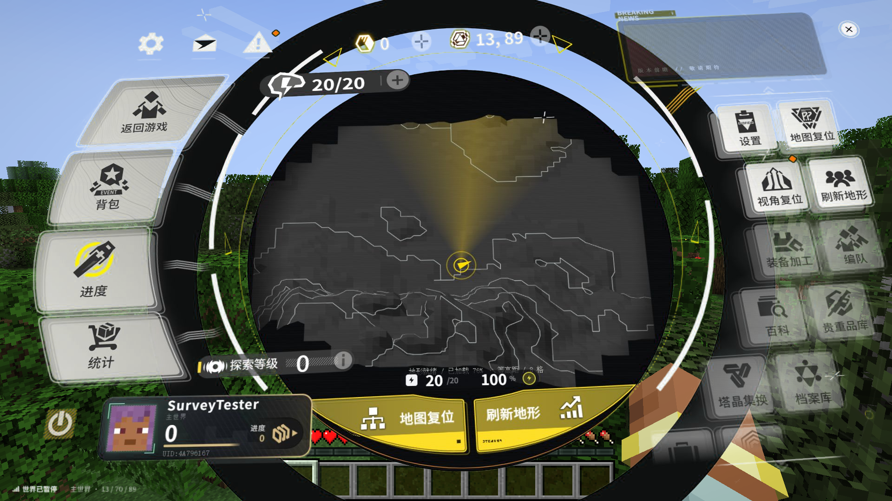
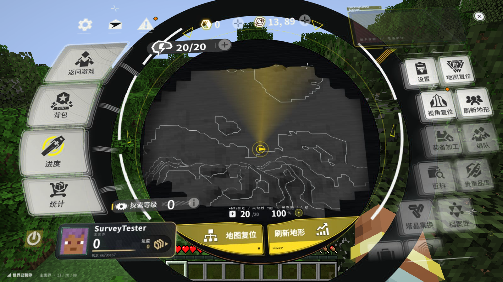
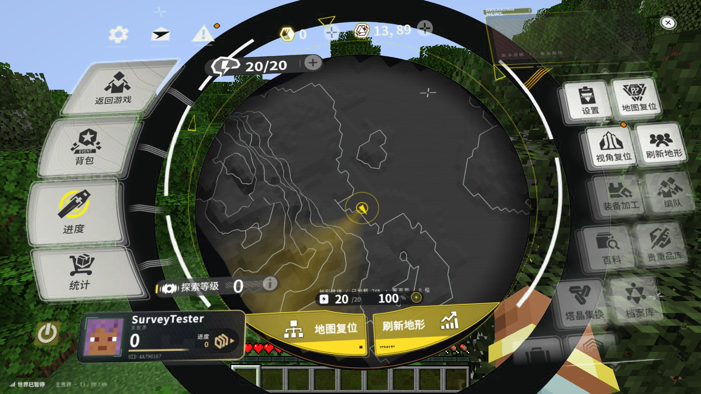
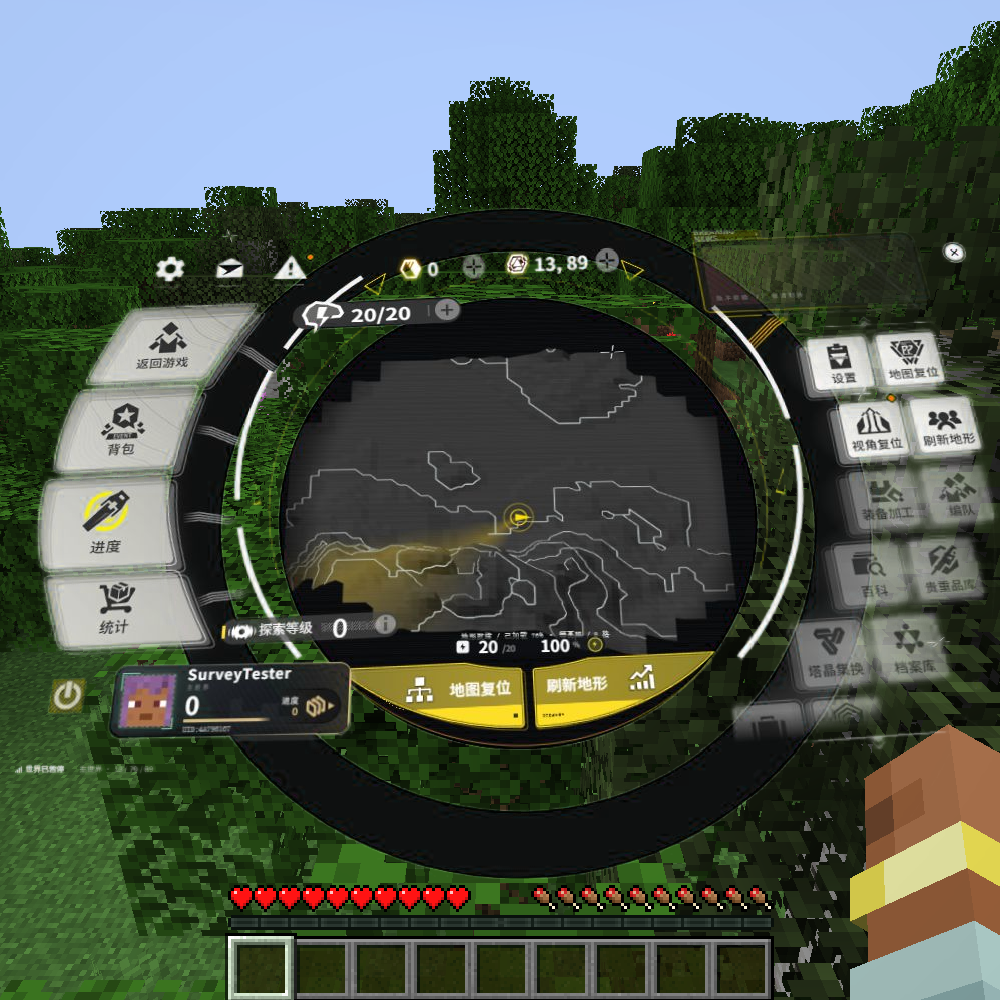

# 1.2.0 透明与菜单生命周期修复验证

2026-10-24，Windows x64、NVIDIA RTX 4060 Laptop、驱动 581.80、Java 21、
Minecraft 1.21.1、NeoForge 21.1.251、原版 ApricityUI 1.2.8。
测试客户端关闭垂直同步并限制游戏主循环 120 FPS；这不是网页捕获帧率。

## 已验证的修改

菜单继续直接运行附件原 HTML 与 20 个组件脚本，`verifyOriginalPage` 全部通过。
适配脚本和响应注入去除全屏底色、壁纸、压暗遮罩及外部字体请求。
原始附件文件没有改写。

AUI JAR、其 Java class 和原生 DLL 均未替换。依赖 JAR 的 SHA-256 在修改前后为：
`7636ae43311b5401b13776799fb79cf4122b23db7fe4ae6ca03a94b14acbc0f6`。

客户端 mixin 仅对 `endfield/host.html` 中 `original-page` 生效：

- `IframeMixin` 接管实际 framebuffer 大小与菜单纹理合成，显式控制捕获启停。
- `FrameUpdateChannelMixin` 在该菜单接收期间使用小端批量像素读取。
- `NativeImageAccess` 取得当前图像内存地址；`MenuFrameUpload` 按行写入并合并上传。
- 其他 iframe 沿用 AUI 原路径；没有修改 native 捕获算法。

原版 iframe 的 JPEG 捕获不携带 alpha。本版保留专用绿色底色到 GPU，
合成 shader 提取空白的透明度和软阴影，皮肤头像使用独立不透明区域保护绿色。
这是底色提取合成，并非 WebView 原生透明通道；有损编码可能在细小半透明边缘留下轻微误差。

`MenuSession` 在进入世界后预热浏览器，普通开关和打开原版子菜单复用同一浏览器及 AUI 文档。
关闭时停止页面 rAF、场景动画和原生捕获，退出世界才释放资源。
新页面有独立代号，旧页面的回报和操作不会污染重载后的页面。
保持原展开动画，返回游戏仍等待约 520 ms 收起动画。

地形采样仍只在客户端线程读取已加载区块；不可变高度场的网格生成与 JSON 编码移到工作线程。

## 实机结果

`gradlew runClient -PruntimeQa --offline`：**77 条运行断言全部通过**。
包含原版菜单功能、单人暂停、真实地形和等高线、拖动与缩放、原生尺寸、
浏览器／文档复用、隐藏后暂停动画、窗口缩放、宿主重载、退出确认和保存。
几何单元测试 **5 项通过**，`build sourceBundle` 成功。
运行摘要见 [runtime-qa-1.2.0.log](runtime-qa-1.2.0.log)。

| 检查项 | 观测结果 |
| --- | --- |
| 1600×900 请求与实际捕获 | 1600×900，旧版为 1461×821 |
| 1280×720、1000×1000 | 请求与 native 状态均匹配实际 framebuffer |
| 1920×1080 独立检查 | 实际捕获 1920×1080，无面积降采样 |
| 预热后的菜单 init | 多次约 0.53–0.91 ms |
| removed 中的关闭处理 | 多次约 0.10–0.56 ms，不含保留的 520 ms 动画 |
| init 到首次绘制 | 多次约 4.8–16.2 ms，不代表首个新浏览器图像已到达 |
| 游戏主循环 | 约 117–119 FPS，稳定阶段帧间隔 P95 约 9.7–10.0 ms |
| 网页 JPEG 捕获 | 1600×900 多轮约 30–47 FPS；1920×1080 单次约 27 FPS |
| PNG 对比 | 1600×900 约 5 FPS，回读／编码往返约 359 ms |

**稳定 60 FPS 网页更新目标未通过。** 开关主线程耗时和清晰度有对应验证，
不能用游戏主循环 118 FPS 或浏览器 rAF 计数替代实际网页捕获率。
捕获比较见 [capture-comparison-1.2.0.log](capture-comparison-1.2.0.log)。

当前 AUI 原生宿主使用 `CapturePreview` 编码与回读，并根据捕获延迟调整并发。
这些逻辑位于 DLL 内，Java mixin 不能直接覆盖 C++ 实现。本次没有改写 DLL、
修改原生内存或降低分辨率来把此项标成通过。

另检查了 NeoForge 1.21.1 的 MCEF 2.1.6 作为可选后端的可行性，但没有将它加入交付依赖。
该包使用 java-cef 提交 `a78e832f9f13c2c688caea3d04d8b84fcd238d94`；
其 `native/CefBrowser_N.cpp` 创建浏览器时采用默认 `CefBrowserSettings`，
没有设置 `windowless_frame_rate`。CEF 此项默认上限为 30 FPS，
而该包的 Java API 没有暴露 `SetWindowlessFrameRate`。
因此仅把当前路径替换为这个后端不能据此承诺 60 FPS；未进行 MCEF 实机测试。
源码依据：[对应提交](https://github.com/CinemaMod/java-cef/blob/a78e832f9f13c2c688caea3d04d8b84fcd238d94/native/CefBrowser_N.cpp#L1007)、
[CEF 帧率设置说明](https://github.com/chromiumembedded/cef/blob/6533/include/internal/cef_types.h#L604)。

透明截图中，1920×1080 世界画面与菜单画面三个空白探针的 RGB 完全一致：
`(20,20)=145,172,222`、`(40,20)=145,173,223`、`(80,20)=145,173,224`。
并已人工查看真实游戏截图。

## 截图

## 验证边界

多人、Realms、光影及其他显卡未实测。4K 捕获和完整整合包兼容未实测。
原生 WebView 释放时仍可能输出 `Chrome_WidgetWin_0 / 1411`，测试存档保存与进程退出成功。
测试中还记录过 AUI 输入路径的 GLFW `Invalid scancode 184`，未导致本轮断言失败。
本版精确要求 AUI 1.2.8，以避免把未经检查的 mixin 注入点应用到其他版本。
