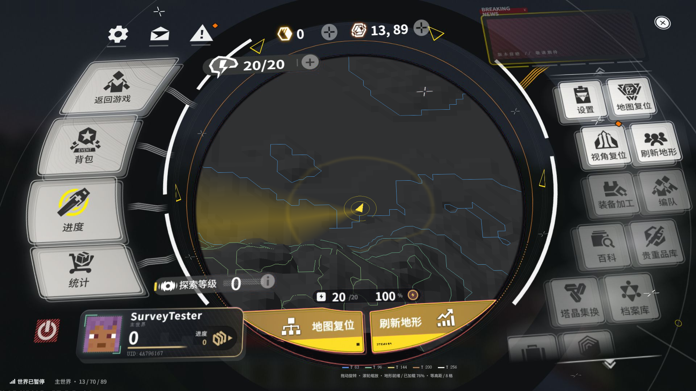
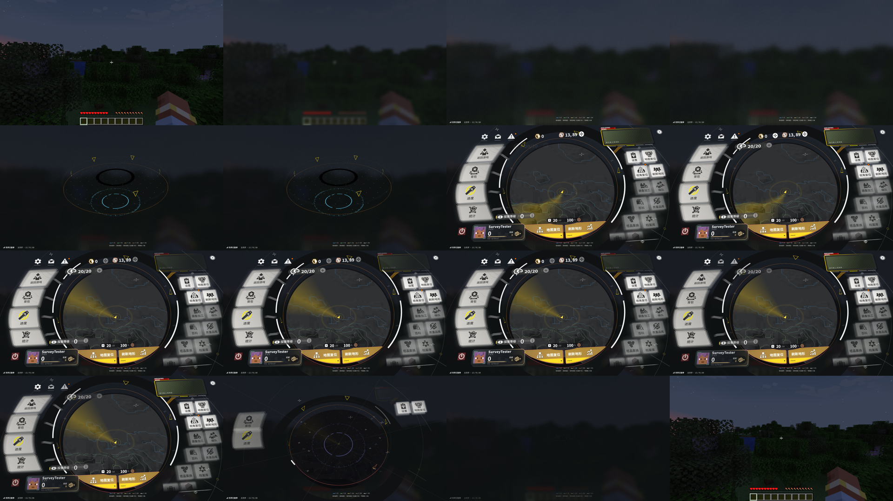

# 1.4.0 验证记录

本版恢复原 HTML / CSS / SVG 运行时布局和 ApricityUI 输入，原生 shader 负责真实高度场、海拔等高线、玩家扫描光及磨砂。原附件的 index.html 与 20 个组件逐字节保持不变，适配逻辑在独立脚本和本模组 mixin 中。

## 环境与方法

- Windows 11 x64，RTX 4060 Laptop，NVIDIA 581.80，Java 21.0.11。
- Minecraft 1.21.1，NeoForge 21.1.251，原版 ApricityUI 1.2.8。
- 1920×1080，VSync 关闭，游戏上限 120 FPS，渲染距离 6。
- 独立单人世界 `endfield-qa`。QA 调用 Minecraft 键盘与 GLFW 鼠标回调，经过 NeoForge 和 AUI 输入路由；不直接触发 DOM 按钮或调用菜单动作。
- 网页 FPS 仅统计实际提交合成的不同完整图像，单独记录游戏 FPS。

```powershell
.\gradlew.bat test verifyOriginalPage
.\gradlew.bat runClient -PruntimeQa -PqaWidth=1920 -PqaHeight=1080
.\gradlew.bat build sourceBundle
```

13 项单元测试全部通过；最终输入回归记录 36 项通过检查。可选 PNG 模式另做出图冒烟检查，确认原生 1920×1080、透明合成及地图投影正常：实际网页约 **4.42 FPS**，首帧约 238ms。该检查未重复整套输入流程，记录见 [runtime-png-smoke-1.4.0.log](runtime-png-smoke-1.4.0.log)。

## 修复与检查

原 HTML 重新负责图标、文字、卡片、阴影、透视、遮挡、视差、悬浮按下反馈和列表惯性。地图是 HTML 圆盘内的原生纹理：同一捕获图像中编码四角投影、会话编号及地图姿态，GPU 使用该帧数据合成，避免 JavaScript 最新姿态与旧网页图像混用。

帧接收器仅在 full-refresh 的全宽行连续覆盖整张图像后提交 GPU；不完整帧、断序帧与损坏包会被丢弃。AUI 1.2.8 原生协议没有独立帧编号，接收器依赖全刷新行序，不宣称对任意未来协议或任意后端通用。测试覆盖分条接收、截断、重启、断序、缩放和损坏包；投影测试覆盖透视四角、隐藏退化矩阵、无效标记和非有限值。

浏览器进入世界后预热，连续进出、打开子界面和窗口缩放保留同一 viewId。隐藏后关闭捕获并暂停网页动态；退出世界释放文档、服务、纹理及缓冲。使用原生窗口分辨率，不受 AUI 默认 iframe 面积上限影响。

默认 JPEG 模式在网页中放置磨砂世界快照：没有绿色底图或绿色头像占位。PNG 模式保留真 alpha，可通过配置启用。默认背景单人暂停时保持快照，运行中的世界每秒刷新一次；半透明组件由浏览器与该背景自然合成。头像从 MC 皮肤读取，成功前保持深灰。

地形只读取客户端已经加载区块，保留海拔渐变与图例；扫描光由玩家位置向外旋转，附玩家圆环。地图默认放大至覆盖圆盘，未加载区域仍留空。

## 实机结果

完整记录保存在 [runtime-1.4.0.log](runtime-1.4.0.log)，关键指标另存 [metrics-1.4.0.json](metrics-1.4.0.json)。最终完整回归全部通过，逐项检查包含：单人暂停、设置、进度、统计、背包、地图拖动和缩放、地图复位、退出确认、Esc、返回游戏、1280×720 窗口、GUI 缩放 2/3、900ms 展开和 520ms 收起连续截图、三轮进出、右侧滚轮与拖动、鼠标视差、视角复位、刷新地形以及同一浏览器复用。视角复位先通过拖动制造非零旋转再验证归零；刷新通过测绘版本号增加验证，避免仅凭点击成功判定。

最终完整回归的 5 次指标快照中，1080p 实际网页呈现为 **22.28–25.38 FPS**，网页帧间隔 P95 为 **76.05–103.82ms**；游戏为 **117–118 FPS**。隐藏后捕获状态为 `fps=0`，14 次会话沿用同一浏览器 viewId，本轮累计接收 2474 张完整图像，未发生不完整帧丢弃。60 FPS 网页目标尚未达到。

本轮记录的 Java init 为 0.14–1.11ms，但这不等于网页已经出图：首个本次会话完整图像仍需约 **105–269ms**。收起实际测得约 **529–530ms**。保留原 CSS 动画时间，但网页图像采样率低于游戏帧率，仍可看见动画帧步进。默认模式生成磨砂世界快照时也存在一次 GPU 回读，不能据此声称完全消除了开菜单停顿。

捕获状态显示 AUI DLL 内 WebView2 `CapturePreview` 的编码和回读仍有明显耗时；当前 Java mixin 处理了分辨率、上传、合成和生命周期，没有替换该 C++ 捕获实现。本次未修改 AUI JAR/DLL，也未以降低分辨率或游戏 FPS 替代网页 FPS 达标。开发缓存和实际依赖 JAR 的 SHA-256 均为 `7636AE43311B5401B13776799FB79CF4122B23DB7FE4AE6CA03A94B14ACBC0F6`。

默认 JPEG 存在少量压缩边缘误差；地图通过专用洋红色覆盖层合成，头像和整页背景不使用绿色抠图。左上角 256×32 像素的帧元数据区域以相邻背景行替代，可能产生细微背景差异。PNG 透明模式可避免 JPEG 压缩，但捕获更慢。

本轮没有连接外部多人服务器，也未验证第三方光影、非 Windows 或其他 AUI 版本。日志中的 WebView2 退出提示 `Failed to unregister class Chrome_WidgetWin_0` 来自依赖宿主；运行时交互与资源关闭检查通过，仍保留原始日志。

## 截图




