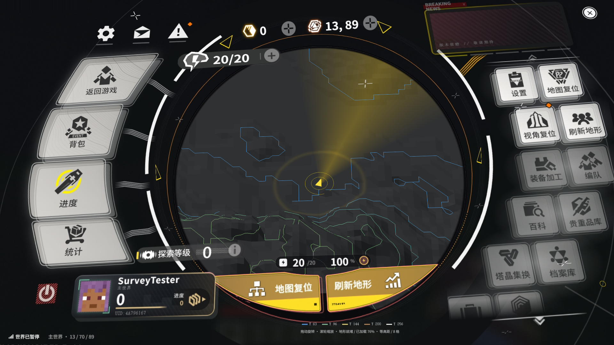
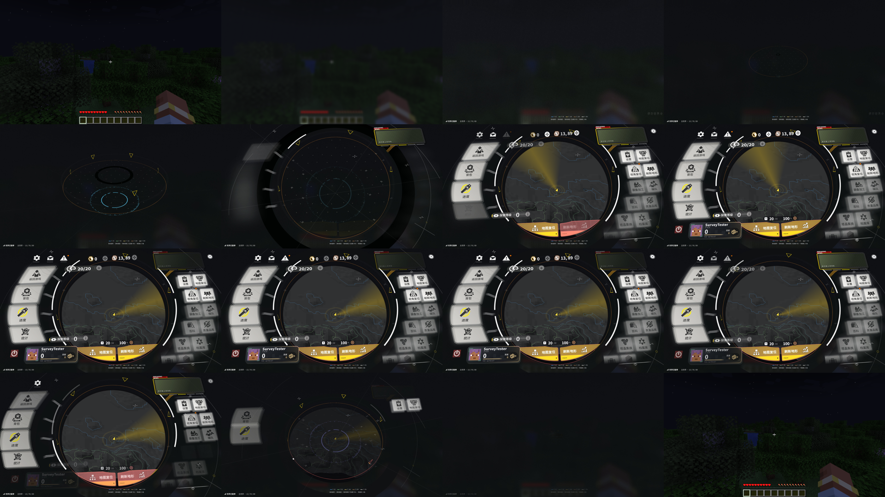

# 1.4.1 连续帧优化验证

沿用 1.4.0 的原生 1920×1080 HTML 界面、AUI 输入、地图 shader 与 900ms／520ms 动画。仅优化捕获、帧解码、背景回读和适配脚本，不修改 AUI JAR／DLL。

## 改动

`NativeWebViewServiceMixin` 只拦截本菜单的浏览器创建。菜单使用独立 WebView2 profile，通过本机随机端口连接该浏览器的 `Page.startScreencast`；浏览器仍由 AUI 创建，鼠标、焦点、拖动、滚轮与键盘继续经过 AUI。仅在创建期间设置 WebView2 连接参数，随后恢复原进程环境值；启动器已有调试参数时直接沿用 AUI 捕获。

默认 JPEG 质量为 95，不缩小页面或窗口。工作线程解码完整图像，队列只保留最新一帧，GPU 一次提交完整纹理；帧内携带同一时刻的地图投影、会话编号和姿态。通道不可用或中断时自动恢复 AUI `CapturePreview`，原共享内存完整帧接收器仍负责防止分条撕裂。关闭菜单停止帧流，退出世界关闭连接并释放缓冲。

逐字节相同的 JPEG／PNG 图像会在解码前去重，不计为新呈现帧。最终去重冒烟检查收到 291 帧、跳过 1 张重复图像，实际呈现 **67.59 FPS**，P95 为 30.11ms；记录见 [runtime-dedup-1.4.1.log](runtime-dedup-1.4.1.log)。

磨砂背景改为 PBO 提交和零超时 GPU fence 轮询，GPU 完成后才复制到 CPU；翻转与 PNG 编码留在工作线程。仍需复制像素，首次创建缓冲也有开销，不能称为零耗时或完全消除开菜单停顿。默认单人暂停保持快照，运行中的世界每秒更新。

适配脚本复用地图元数据数组和画布像素，仅在数据变化时重画；玩家与文字状态仅在变化时更新。发行版关闭持续的命中区域诊断；实机 QA 保留诊断，查询节流至约 120ms。原 `index.html` 和 20 个组件文件逐字节保持不变。

## 测试方法

Windows 11、RTX 4060 Laptop／NVIDIA 581.80、Java 21.0.11；Minecraft 1.21.1、NeoForge 21.1.251、ApricityUI 1.2.8。1080p，VSync 关闭，游戏上限 120 FPS，渲染距离 6；与 1.4.0 使用同一个隔离 QA 世界。

```powershell
.\gradlew.bat test verifyOriginalPage runClient -PruntimeQa -PqaWidth=1920 -PqaHeight=1080 --offline
.\gradlew.bat build sourceBundle --offline
```

实机 QA 通过 Minecraft／GLFW 输入回调进入 AUI，不直接触发 DOM 按钮。覆盖设置、进度、统计、背包、地图拖动／缩放／复位、退出确认、真实 Esc 和返回按钮、窗口和 GUI 缩放、右侧列表滚轮／拖动、鼠标视差、视角复位、测绘刷新、连续进出及隐藏停止捕获。

扩展检查主动关闭连续帧连接，验证自动回退后仍能通过真实鼠标打开设置；临时关闭菜单暂停，验证单人服务器继续推进且磨砂快照更新。这不能替代连接外部多人服务器的兼容性测试。

完整回归 46 项检查通过，13 项单元测试通过。退回旧通道后又做 11 项定向检查并全部通过，记录见 [runtime-fallback-1.4.1.log](runtime-fallback-1.4.1.log)。切换通道时清空 FPS 采样，避免旧通道和新通道指标混算；同一配置重新进入世界能建立新的浏览器会话并重新连接连续帧。

另做原生 1080p PNG 模式出图检查：地图投影与透明合成正常，网页实际呈现 **25.71 FPS**，对比 1.4.0 PNG 冒烟检查的 4.42 FPS 有提升，但仍慢于默认 JPEG。PNG 本轮只验证出图，未重复全部输入流程。

## 数据与限制

最终回归结果、性能指标及截图见本目录的 `runtime-1.4.1.log`、`metrics-1.4.1.json` 和 `screenshots/hybrid-1.4.1-*.png`。网页 FPS 按实际呈现的不同完整图像统计，和游戏 FPS 分开。

| 同一测试节点的网页实际呈现 | 1.4.0 | 1.4.1 |
|---|---:|---:|
| 首次打开，约 4 秒后的累计快照 | 23.41 FPS | 52.48 FPS |
| 交互和热身后的稳定快照 | 25.38 FPS | 67.94 FPS |
| 展开／收起截图期间的快照 | 22.28 FPS | 54.57 FPS |
| 连续进出后的快照 | 23.69 FPS | 67.74 FPS |
| 再次进入世界后的快照 | 未测 | 68.44 FPS |

1.4.1 网页帧间隔 P95 为 **25.85–41.09ms**（1.4.0 为 76.05–103.82ms）。游戏热身后约 116–118 FPS；首次打开的早期快照为 73 FPS，不能省略这段启动开销。首个会话首帧约 **272ms**，复用约 **111–146ms**，重新进入世界约 184ms；首帧没有显著突破 1.4.0 的约 105–269ms 范围。收起约 **523–534ms**，未缩短用户确认的动画长度。

磨砂异步回读首次记录提交约 **4.32ms**、完成后复制约 **0.72ms**，热身后多数提交／复制分别低于 1ms；准确数值保留在 JSON 的 `backgroundReadback` 中。连续帧 JPEG 解码通常约 10–13ms，上传约 1ms，仍不是 GPU 共享纹理零拷贝。

完整回归早期日志的 `fallback metrics` 跨越通道切换，包含此前连续帧样本，不作为回退性能依据。修正统计后的定向验证中，AUI 回退捕获约 **33.60 FPS**，重新进入世界恢复连续帧后约 **70.81 FPS**。回退维持可用性，不能保持新通道的帧率。

平均帧率超过 60 不代表稳定锁定 60；连续帧传输、JPEG 解码、游戏渲染和 GPU 上传仍会产生抖动。未验证第三方光影、其他 AUI 版本或非 Windows 平台。JPEG 边缘误差与左上角元数据背景替代区域仍沿用 1.4.0 的限制。

WebView2 在退出时仍可能输出依赖宿主的 `Failed to unregister class Chrome_WidgetWin_0` 提示；本轮运行时检查通过，原始日志保留该提示。





原版 AUI 依赖 JAR 的 SHA-256 保持 `7636AE43311B5401B13776799FB79CF4122B23DB7FE4AE6CA03A94B14ACBC0F6`。所需接入全部位于本模组及其 mixin 中。
