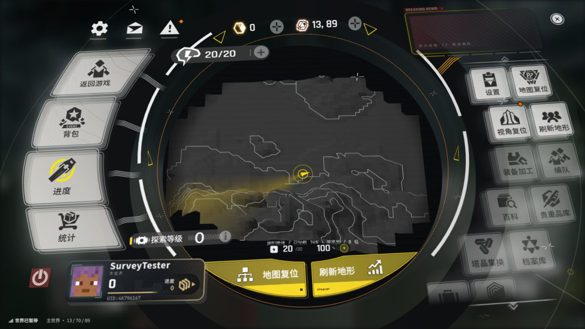
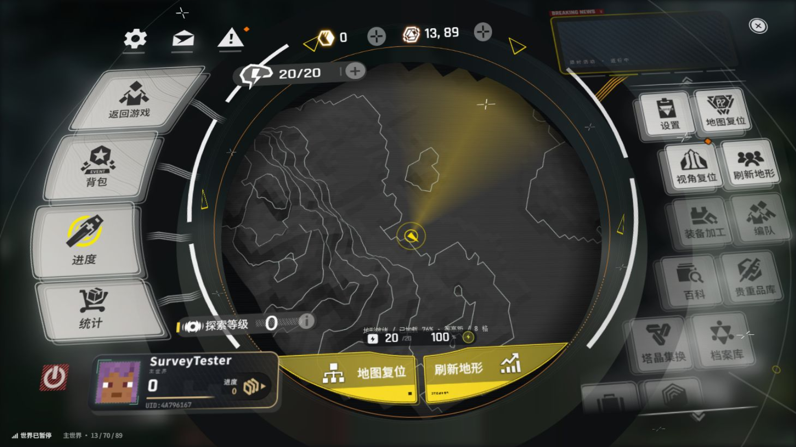
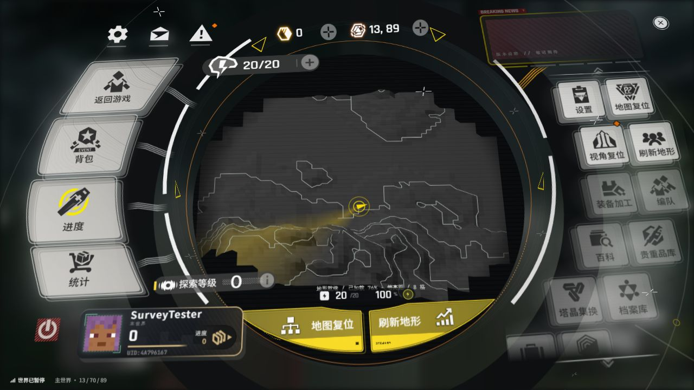
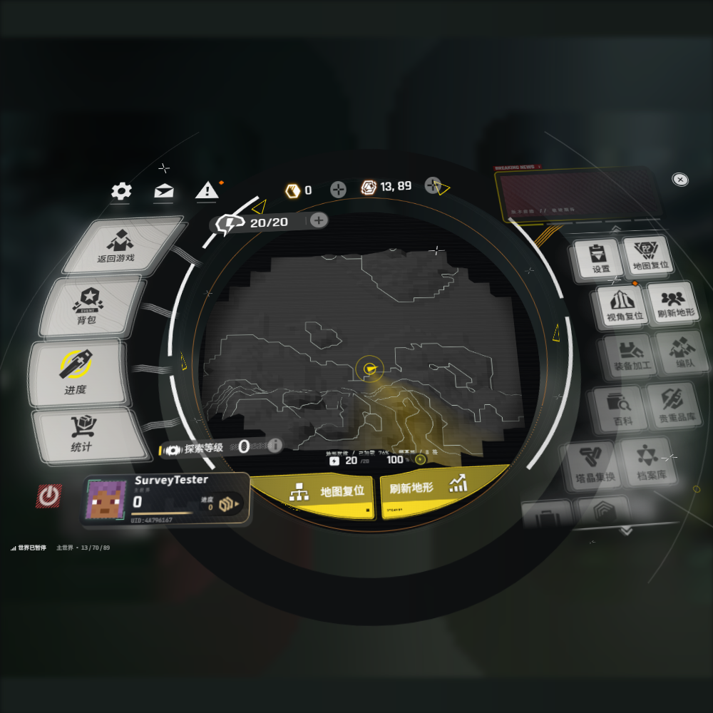

# 1.1.0 原网页接入验证

2026-10-24，Windows 11 x64、RTX 4060 Laptop、Java 21.0.11、Minecraft 1.21.1、
NeoForge 21.1.251、ApricityUI 1.2.8 原始发布 JAR，使用 AUI 自带的 WebView2 后端。
没有安装 KubeJS 或 Rhino。

## 直接使用附件

`index.html` 与 20 个 `components/*.js` 均和附件逐字节一致。
`gradlew verifyOriginalPage` 检查该要求，已接入 `build` 的 `check`。
SHA-256 清单见 [original-source-sha256.txt](original-source-sha256.txt)。

原页面由 AUI `host.html` 的全屏 iframe 承载，HTML 响应中仅插入错误报告脚本和
新增 `minecraft.js`。原布局、场景透视、SVG 图形和进出动画由浏览器执行。
MC 标签、按钮映射、鼠标修正和中央 canvas 在新增适配脚本里完成。

原生 AUI/Rhino 路径已实测，遇到 `window.EF` Java 对象属性及 `insertAdjacentHTML`
缺失错误，因此采用 AUI 1.2.8 发布 JAR 自带且文档明确支持的 WebView 宿主。
没有修改 AUI 二进制。

## 实机验证

通过 `gradlew runClient -PruntimeQa` 在独立 `run/saves/endfield-qa` 世界测试。
最终一轮 **66 条运行检查全部通过**；`build sourceBundle` 成功，**5 项几何单元测试通过**。
通过 AUI iframe 的鼠标事件转发，实际在浏览器页面里按下和松开鼠标；没有绕过
网页按钮直接调用 MC 功能。检查浏览器回报的命中目标、地形数据和渲染状态。

- Esc 替换及单人暂停。
- 原页面脚本无错误，真实地形网格和等高线进入 WebGL。
- 设置、进度、统计、背包打开及返回。
- 地图拖动／滚轮改变旋转、俯仰和缩放。
- 地图复位、刷新地形、宿主 DOM 重载后重新挂接。
- 退出确认与取消、返回游戏。
- 1280×720、1000×1000 下，各功能的可见点击中心通过浏览器 `elementFromPoint` 验证。
  原卡片的透明 SVG 包围盒可能超出屏幕，不以透明盒边缘误判可见卡面。
- 确认退出后返回标题，测试存档保存完成。

几何单元测试覆盖斜坡精确交点、未加载区块、平地、负高度和全部缺失数据。
本轮测试日志摘要见 [runtime-qa.log](runtime-qa.log)。

## 截图

## 限制

AUI 1.2.8 的 WebView 只支持 Windows x64 与 WebView2 Runtime；捕获分辨率有面积上限。
原网页 Google Fonts 无法访问时使用浏览器后备字体。
关闭 WebView 时，原生后端有时输出 `Failed to unregister class Chrome_WidgetWin_0 (1411)`；
它发生在页面释放期间，已通过保存退出与进程正常结束检查，没有修改第三方原生库。
多人、Realms、其他模组维度、光影包及其他显卡未实测。
网页装饰文字与美术保留，MC 功能标签覆盖三种语言；繁体与英文资源已校验键一致。
